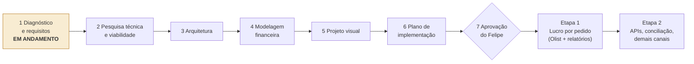

# Roadmap

Atualizado em 2026-11-13. Versão visual (privada, conta do Felipe): https://claude.ai/artifact/LVifwWVvkMQBGVT1PYDDTE

**Regra:** nenhum código, planilha ou integração antes da aprovação explícita da Fase 7.

## Agora: fechar a Fase 1

Itens que o Felipe precisa trazer:

- [ ] Prints das regras de tributação e da natureza de operação no Olist
- [ ] Um pedido de kit do Olist (composição e custo)
- [ ] Relatório de cobranças do Mercado Livre e da Amazon, sem dados pessoais de clientes
- [ ] Confirmar que é administrador de cada conta de marketplace (credenciais de API)
- [ ] Conferir se "Aplicativos API V3" aparece em Configurações da conta Olist (plano Domine)

Depois, segunda rodada de perguntas: custos fixos mensais, faturamento aproximado, prazo de repasse de cada canal, quantidade de SKUs ativos e quem mais usará a planilha.

## As 7 fases

| # | Fase | O que entrega | Status |
|---|---|---|---|
| 1 | Diagnóstico e requisitos | Requisitos organizados, dúvidas e perguntas | Em andamento |
| 2 | Pesquisa técnica e viabilidade | Matriz: informação, fonte, endpoint, disponibilidade, limitações, alternativa. Olist API v3, APIs financeiras dos 5 canais, extratos de fulfillment, ICMS no XML da nota | A fazer |
| 3 | Arquitetura | Fluxo de dados, abas, armazenamento, sincronização, duplicidades, falhas. Sheets x Postgres. Apps Script x n8n | A fazer |
| 4 | Modelagem financeira | Dicionário de dados, fotografia do custo, impostos em 3 camadas, rateio do frete aos centros, regras para 19 exceções, exemplos numéricos | A fazer |
| 5 | Projeto visual | Abas, cabeçalhos, cores, dashboard, filtros, formatação condicional | A fazer |
| 6 | Plano de implementação | Tarefas, dependências, testes, critérios de aceitação, backup e controle de acesso | A fazer |
| 7 | Aprovação | Pacote completo (requisitos, arquitetura, planilha, modelo financeiro, integração, plano, riscos) | A fazer |

## Entrega em duas etapas

**Etapa 1, onde está o prejuízo:** pedidos do Olist de pelo menos 7 dias, relatórios de Mercado Livre e Amazon baixados à mão, lucro por pedido e por SKU, imposto estimado (marcado como estimativa), embalagem, preparação e frete aos centros entrando no custo.

**Etapa 2, automação:** APIs financeiras dos marketplaces, conciliação, demais canais (Shopee, Magalu, KaBuM), fulfillment completo, possível migração para Postgres.

## Decisões tomadas

| Tema | Decisão |
|---|---|
| Base de dados | Google Sheets agora, Postgres depois. Lógica em script, ID único por pedido e item |
| Fonte do pedido | Olist: pedido, itens, SKU, custo e nota |
| Comissão, tarifa e repasse | Do marketplace, por API ou relatório importado. O Olist mostra valores defasados |
| Custo do produto | Copiado para o pedido na importação, nunca relido. Retroativo aproximado e marcado |
| Impostos | 3 camadas: ICMS da nota, federais sobre a receita, calibração mensal. Contador valida os parâmetros |
| Entrega | Duas etapas, do zero, com pelo menos 7 dias de histórico para teste |

## Pendentes

| Tema | Situação |
|---|---|
| API v3 no plano Domine | Pesquisa indica que sim (120 requisições por minuto). Confirmar na conta |
| n8n | Avaliar na Fase 3. Não obrigatório |
| Critério de rateio dos custos indiretos | Fase 4, depende dos custos fixos |
| Regras de ICMS e substituição tributária | Prints do Olist e confirmação do contador |

## Riscos

- Tarifas reais fora do Olist: relatório diário agora, API por canal onde existir.
- Frete aos centros não contabilizado: lucro dos produtos em fulfillment superestimado hoje. Rateio por lote na Fase 4.
- Limites do Google Sheets (10 milhões de células, cotas do Apps Script): dados tabulares e IDs estáveis para migrar.
- Custo antigo desconhecido: fotografia daqui para frente, retroativo aproximado.
- Imposto por pedido é estimativa gerencial: conferir todo mês com o contador.
